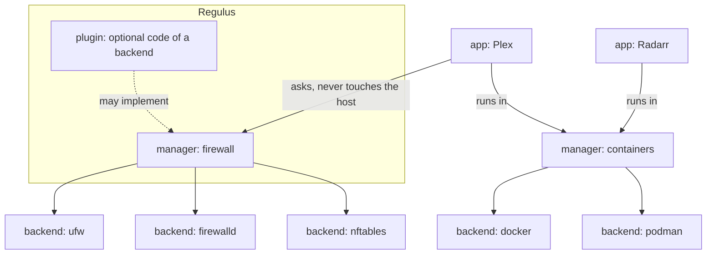

# Managers, backends and apps

**Status: design only. Nothing on this page is implemented.** It records the vocabulary and the direction agreed on 2026-11-19, so that the design issues of epic #286 start from the same words. Where a point is still open it says so.

Regulus will do more than observe servers. It will manage some of their functions (RAID, the firewall, containers, a VPN, Wake-on-LAN…) and run third-party software (Plex, Radarr, Sonarr, TriliumNext…). Four words were in use for overlapping things: *extension*, *plugin*, *add-on*, *snippet*. They are replaced by four words with four different meanings.

## The four terms

| Term | What it is | Is Regulus code? | Examples |
|---|---|---|---|
| **plugin** | A program that extends Regulus: a separate process speaking gRPC on a local socket, described by `plugin.yaml` ([plugins](plugins/README.md)). Unchanged. | yes | the code of a backend (when it is not built in), #163 |
| **manager** | A function of a server that Regulus manages, with one or more backends to choose from. | yes (the part that shows and changes its state) | RAID, firewall, containers, VPN, wake |
| **backend** | The real tool behind a manager. **One active backend per manager per server.** Regulus does not write its own version of what a backend already does. | no, it is an existing tool | mdadm, ufw, docker, tailscale |
| **app** | Third-party software that runs **in containers** on a server, described by a declarative manifest and taken from a catalog. | no | Plex, Radarr, Sonarr, TriliumNext |

Not used: **extension** and **add-on** (synonyms of plugin: two words for one thing), and **snippet** (no feature needs it; the word is free if a feature for saved commands or configuration fragments is ever designed).

Why *manager* and not *capability*: the glossary already uses **capability** for what a node type does by default (`relay`, `notifications`, `backup-storage`; #104, #160, #169). Using it twice would make "does this node have the firewall capability?" ambiguous. *Manager* is also the word the maintainer already used ("container management", "WOL manager").

### How they fit together

- A **manager** is a function; a **backend** is a tool; a server has at most one active backend for each manager. A manager that the server cannot support (no `ufw`, `firewalld` or `nftables` at all) is shown as unavailable, not as an error.
- A manager can be **built in** or implemented by a **plugin**. The rule is not decided: reading state is a collector in the core; changing state is dangerous and a candidate for a plugin with explicit permissions and isolation (see the open questions).
- An **app** needs no plugin and no Regulus API. It is data (a manifest) plus containers. If an app needs something from the host, such as an open port or a VPN, it asks the matching manager; the app never touches the host itself.

## Managers

The first column of each row is the manager; the backends are the tools Regulus would use. "Observe" means Regulus reads and shows state; "manage" means it also changes it. The scope of each manager is decided in its own issue, not here.

| Manager | Backends (proposed) | Notes | Issue |
|---|---|---|---|
| **Containers** | Docker, Podman | The runtime of apps. The common format is the Compose specification. Kubernetes is out of scope for now. | #289 |
| **Firewall** (of one server) | ufw, firewalld, nftables | nftables is the kernel layer; ufw and firewalld are front-ends on top of it, so they are not four equal choices. Regulus detects the one the distribution uses (ufw on Debian and Ubuntu, firewalld on RHEL and Fedora) and uses one per server. iptables is not supported. Docker and Podman also write firewall rules. Not the same as the firewall node of #284. | #290 |
| **VPN** | Tailscale first, then WireGuard, NetBird or Headscale | Optional, never required (a mandatory overlay was rejected for Regulus Access). Tailscale runs on the host, so it is a backend, not an app. | #291 |
| **Wake** | none to choose | Wake-on-LAN. A magic packet reaches only the local network, so the hub asks an agent on the same network to send it. A new state, *asleep*, next to offline. | #292 |
| **RAID** | mdadm; ZFS and Btrfs as filesystems | Already designed in #285 (observe or manage, storage or servers). LVM is **not** an alternative to mdadm: mdadm builds arrays, LVM builds logical volumes on top. | #285 |
| **Storage and volumes** | LVM, filesystems | The layer between the disks (#147) and the apps: mounts, logical volumes, free space. | #293 |
| **Shares** | Samba, NFS | | #294 |
| **Backup** | restic, borg | The function on each server. The backup node (#166) and the hub backup (#253) are separate issues; their relation is open. | #295 |
| **Reverse proxy and certificates** | Caddy, Traefik, nginx | Publishes apps with TLS. Nothing is public without an explicit choice. | #296 |
| **UPS** | NUT | Clean shutdown, power-return wake-up. | #297 |
| **System updates** | apt, dnf | The operating system's packages. **Not** Regulus's own updates ([updates](updates.md)). | #298 |
| **Scheduled jobs** | systemd timers, cron | One list of what runs on a schedule on a server. | #299 |
| **Virtual machines** | libvirt (KVM) | For what containers cannot do. A decision "build or not" first. | #300 |

The design of the model itself (what a manager is in code, how a backend is detected and chosen, built in or plugin, privileged actions, guards for dangerous operations) is #287.

## Apps

**Decision (2026-11-19): apps run in containers.** The alternative that was weighed was software installed natively in a dedicated volume as a systemd service. It was not chosen because every program would need its own installation, update and cleanup method, and Regulus would have to know each one. A container gives isolation, a clean removal and one format. The worry about "endless containers" is mostly about appearance: a container costs little, and the dashboard shows an app, not its containers.

What an app is, as proposed (the design is #288):

- A **manifest** built on the Compose specification, so that Docker and Podman both read it. Regulus adds what it needs: id, version, title, the Regulus versions it works with, the volumes it declares, the ports, the environment with **secret references** (never secrets in the manifest), the host resources it asks for (a media folder, a GPU) and the permissions it needs.
- A **data volume** per app, in a directory Regulus owns (for example `<apps dir>/<id>/data`). The volume is where the app's data lives; **removing an app can keep or delete it**, and the administrator chooses.
- A **catalog**: an index with checksums and signatures, like the plugin index of #20, with a `source` field so other catalogs can be added later (trust model: #23).
- The same three **update modes** as the core (`manual`, `download`, `automatic`), per app.
- **Redundancy:** a redundant hub replicates the **definition** of an app, never its data ([hub redundancy](hub-redundancy.md) and #113). The data is the business of the backup manager.

The first apps (Plex, Radarr, Sonarr, TriliumNext; then Jellyfin, Pi-hole, AdGuard Home, Nextcloud, Immich) are chosen in #301, after the manifest exists.

## The model and the scope of each manager

These sections are the agreed design (each issue is linked in its heading). They set what each manager observes, what it may change, and the guards; nothing here is implemented.

### The model of managers and backends (#287)

**Agreed.** Every manager follows the same rules, so that none of them invents its own.

1. **A manager is a contract in the core**, not free code: a named set of **observations** (read state) and **operations** (change state), with a typed shape for its data, versioned like the other contracts ([Versioning](versioning.md)): fields are only added. The dashboard and the console show a manager from that data; nothing in the GUI is written per backend.
2. **A backend is detected on the server**, by the agent: the tool is installed, its service is active, its version is known. The agent reports it as `manager`, `backend`, `version` and `state` (`absent`, `inactive`, `active`) with its other data. **One active backend per manager per server.** When several fit (ufw and firewalld both installed), the administrator chooses and the choice is kept in the hub; Regulus never drives two at once. When the detected tool changes (ufw removed, firewalld installed), the manager shows `backend_changed` and **refuses every change until an administrator confirms the new backend**: the rules the administrator saw belong to another tool.
3. **Observing is in the core, changing is a closed list of core operations.** Reading state is a collector of the agent (no root where the tool allows it: `/proc/mdstat`, `findmnt`, `ufw status` through the helper only when it must). Changing state is a **named operation with validated arguments** (`firewall.allow_port{port, proto, source}`), executed by the root helper of #60, **never a shell and never a free command line**. Managers do **not** run as plugins in this series: a plugin cannot be isolated enough until #267 and #261 exist, and a manager that changes a firewall is exactly what must not depend on them. The decision is revisited when #267 ships.
4. **Privilege.** The helper has one entry point per manager and, in it, a list of operations built into the *verified* executable (the same rule as the update helper: it trusts nothing the agent's user could have written). No operation takes a path or a command from the request unless the manager's page names the directory it may touch.
5. **Guards, by level.** Each operation has a level, fixed in the contract:

   | Level | Meaning | Guard |
   |---|---|---|
   | 0 | reads state | the manager's `*.read` permission |
   | 1 | reversible, cannot lock anyone out (open a port, rename a share) | permission `*.manage`, audit entry |
   | 2 | can cut the administrator or the agent off (a firewall rule, a VPN leave, a network change) | level 1, **step-up**, and an **automatic revert**: the hub keeps the previous state and restores it unless the administrator confirms within 60 seconds (the `commit-confirmed` pattern); the revert runs on the agent, so it works when the hub cannot be reached |
   | 3 | destroys data or cannot be undone (wipe a disk, destroy an array, delete a volume, remove an app's data) | level 2 without the revert, plus **typing the name of the target**, a **delay of 60 seconds that can be cancelled**, and never available to an API token (#388) |

   Every level 1 to 3 operation is an audit event with a code and arguments (what, which server, who).
6. **Observe first.** A manager ships its observation before any operation. Whether and when it gets operations is decided in its own section below, and each starts with level 0 only.
7. **In the GUI and the console.** A server page has a **Managers** section; a manager is **off until an administrator turns it on for that server** (an agent that reports `absent` shows "not installed" and nothing else). Observations are also in the console, read-only. Every text is in English and Italian; the Italian word for manager is *gestione*. Each manager has its own permissions (`<manager>.read`, `<manager>.manage`), listed in `users.perm.*` like the existing ones.
8. **What `provides` in the plugin manifest is for** is unchanged and still unused; managers do not use it.

**Rejected:** managers as plugins (above); one generic "run this command" operation (it would move the guard to whoever writes the command); letting a backend be chosen per operation (two tools would disagree about the state); an automatic switch to a newly detected backend.

**Implementation issues.** (1) The common contract: `ManagerState` in the agent protocol (add-only), detection and the `backend_changed` rule (M6, depends on #261). (2) The root helper for managers: one entry point, the operation list and the level checks (M6, with #60). (3) The commit-confirmed revert on the agent (M6). (4) The **Managers** section in the dashboard and the console, English and Italian (M6). (5) `[Test]` for the revert on a real server (M6).

### RAID (#285)

**Agreed: observe, do not manage. Build no new redundancy.** "RAID" means two things and they stay apart: **storage redundancy** (disks) is observed here; **server redundancy** is the hub design ([Hub redundancy](hub-redundancy.md), #103) plus the backup node (#166), and nothing more is built for other workloads: keepalived, Pacemaker or the platform's clustering are shown if present, not replaced. A cluster manager is out; per-container redundancy stays in the backlog (#113).

| Technology | Regulus | Why |
|---|---|---|
| Linux software RAID (`mdadm`) | **reads** (`/proc/mdstat`, `/sys/block/md*/md/`): array, level, members, `degraded`, rebuild progress, failed member | needs no root, in the collector next to SMART (#149) |
| LVM mirror or RAID | reads with the storage manager (#293) | LVM is not an alternative to mdadm: it builds volumes on top |
| ZFS, Btrfs | **reads** pool or filesystem health, scrub state and degraded devices | read-only commands of the tool, through the helper only if root is needed |
| Hardware controllers | **leaves out** | every vendor has its own tool; not now |
| Cloud and virtual disks | **reports only** that redundancy is the provider's | nothing to read or do |

- **Managing** (create, add or replace a member, start a rebuild) is **not in this series**. If it is ever built it is level 3 of the model (typed name, a delay, no API token) and a decision of its own; no operation exists until then.
- **A RAID member** is a disk like any other: it keeps its disk identity (#148), shown on the array; a replaced member is a line in the lifecycle log of #150 (old identity out, new in, rebuild started and finished).
- **What the administrator sees:** health (`clean`, `degraded`, `rebuilding` with percent, `failed`), the members and their SMART state side by side, and an **alert** when redundancy is lost (`raid_degraded`, a new condition of [alerts](alerts.md), critical).

**Rejected:** managing arrays now; a RAID plugin (see the model); a cluster manager.

**Implementation issues.** (1) The `mdadm` collector and `raid_degraded` data in the report (M6). (2) ZFS and Btrfs health in the collector (backlog). (3) The array view on the Disks page (M6, English and Italian). (4) The `raid_degraded` alert condition (with the alerts work).

### Containers (#289)

**Agreed.** Apps run in containers, and the runtime is a **backend**: **Docker** or **Podman**, one active per server (the rule of the model). The common format is the **Compose specification**. **Out of scope:** Kubernetes and Swarm, until someone needs them (#113 keeps the question).

- **Rootful or rootless.** Docker is normally rootful; Podman can run **rootless**. Regulus runs containers **rootless with Podman when the server has Podman and a user to run them as**, and rootful Docker otherwise. The first is preferred because a container escape then lands in an unprivileged user. Which one is used is shown on the server and chosen by the administrator when both exist.
- **Privilege.** Access to the Docker socket is root. **The agent never gets the socket**, and neither does an app. Every container operation runs in the root helper of #60 as a **closed list**: list, inspect, start, stop, restart, logs, pull an image, `compose up` and `down` **for a project Regulus created** from a validated definition. There is no `docker run` with free flags. With rootless Podman the same list runs as the dedicated user instead of root.
- **What an app can never ask for:** `privileged`, the host network, the host PID or IPC namespace, `cap_add` beyond a short list the manifest can name (`NET_BIND_SERVICE`), devices other than the ones a declared resource gives (a GPU), mounting the Docker or Podman socket, or mounting a path outside the volumes and resources it declared. The helper rejects the definition, not only the GUI.
- **What the dashboard shows and does:** each container and its state, start, stop, restart, logs (the last lines, followed), CPU and memory, the image and whether a newer one exists. No shell into a container in this series (that is the node access design, [Web terminal and file browser](node-access.md)).
- **What Regulus stores** for a container is the **record of #113**: identifier, runtime, image reference with its digest, the definition, the declared volumes, the restart policy and where it came from (an app, or found on the server). It never stores the data, and a container it did not create is **shown, not managed**.
- **Firewall.** Docker writes its own rules and a published port can bypass the host firewall. The container manager reports the ports it publishes and the firewall manager (#290) shows them in their own group, "published by containers", so the picture is not wrong by omission.
- **Installing the runtime.** Regulus **detects** Docker and Podman; it does not install them in this series. Installing a package is the system updates manager's work (#298) and would be a level 2 operation there.

This resolves the first item of #113: the container runtime is a backend chosen per server, Docker or Podman.

**Implementation issues.** (1) Detection and the observation of containers, read only, through the helper (M6). (2) The operation list and the definition validator (M6). (3) The containers section of a server in the dashboard, English and Italian (M6). (4) The ports a container publishes in the report (M6). (5) `[Test]` on a real server with Docker and with rootless Podman (M6).

### Firewall (#290)

**Agreed: observe first, then manage with a lock-out guard.** This is the host firewall of **one server**. The dedicated node that all outbound traffic goes through is #284 and stays separate.

- **Front-ends.** nftables is the kernel layer; **ufw** and **firewalld** are front-ends on top. Regulus **detects the front-end the distribution uses** (ufw on Debian and Ubuntu, firewalld on RHEL and Fedora) and uses that one; **nftables directly only when there is neither**. **iptables is not supported.** If both ufw and firewalld are active it reports a conflict and does nothing.
- **Observe (first version).** The enabled state, the default policies, the rules as the front-end lists them (port or service, protocol, source, allow or deny) and the ports that listen, from the open-ports collector (#282), side by side: "listening but not allowed" and "allowed but nothing listens" are the two useful views.
- **Manage (second step), level 2 operations of the model:** open or close a port, allow or remove a source, enable or disable the firewall. **Never offered remotely:** changing the default inbound policy to deny, or enabling the firewall, **unless the rules that keep the agent's connection and the administrator's source are already in the list** (the helper checks this itself); deleting every rule; and anything on a server where the manager cannot tell which connection is the agent's.
- **Lock-out protection.** The agent connects **outbound** to the hub, so inbound rules do not cut it, but outbound rules and a default-deny egress would. Every change goes through the revert of the model: the previous rule set is restored by the **agent** after 60 seconds unless the administrator confirms from the dashboard. A change that is confirmed stays.
- **Docker and Podman** also write firewall rules. The rules they add are shown **in a separate group, "published by containers"**, marked as not managed by this manager; a port in that group cannot be closed from here, and the page says why (the container publishes it).
- **Open ports and the traffic map (#282, #283):** the same data. A port row in the ports view can offer "allow" or "block" once this manager is on; until then it only shows the state.
- **Firewall node (#284) and node permissions (#170).** A server behind a firewall node still has its own host firewall; the two are independent and the page says which one a rule belongs to. A node's permission to reach the network (#170) is *not* a firewall rule and is not written here.
- **What an app may ask.** An app **declares its ports**; the firewall manager opens them **only after the administrator agrees**, in a dialog that lists each port, protocol and source (default: the local network, never "anywhere"). Removing the app offers to close them.

**Implementation issues.** (1) Detection and the observation of rules and policies for ufw, firewalld and nftables (M6). (2) The listening-versus-allowed view (M6). (3) Operations and the helper checks, with the revert (M6, after the model). (4) The firewall section in English and Italian (M6). (5) `[Test]`: a rule that would lock out is reverted, on a real server (M6).

### VPN (#291)

**Agreed.** An optional manager; Regulus never depends on a VPN (a mandatory overlay was rejected, [decisions](decisions.md), "Regulus Access: direction"). **Tailscale first**, because it runs on the host as `tailscaled` and is therefore a backend, not an app; **WireGuard** (`wg`) second; NetBird and Headscale only if someone needs them. **One active VPN backend per server.** A second one needs a reason and a decision.

- **First operations (level 0 and 2).** Observe: connected or not, this server's overlay address, the peers (name, address, online), whether an exit node is in use. Operate (level 2, with the revert, because leaving or changing the exit node can cut the server off): **join** with an auth key, **leave**, **choose or clear the exit node**. **Stays on the command line:** access rules (ACLs), Tailscale SSH, `serve` and `funnel`, subnet routing, key rotation: they decide who can reach what, and that belongs in the VPN's own admin console.
- **The auth key.** It is a secret that lets a machine join a network. The administrator enters it **once** in a form; the hub holds it **encrypted with `secret.key`**, sends it to the agent over the mTLS stream in the `join` operation, and **forgets it after the operation**: it is never returned by the API, never written to the audit log (which records "joined with a key", not the key) and never logged. A key with an expiry or a single use is recommended on the form. There is no stored "reference" to a key in the first version.
- **Relation to Regulus Access.** An overlay address is **a candidate in the address list** of #155 (the phone may use it when it can); Regulus does not make the phone or the hub depend on it, and the manager never edits the hub's settings. The access gateway (#161) is unaffected.
- **Firewall.** A VPN interface may need rules (allow traffic on `tailscale0`); the manager **proposes** them to the firewall manager (#290), and the administrator agrees, as for apps.
- **Several VPNs.** Not at once in the first version: a server that has both Tailscale and WireGuard active shows both, manages the one the administrator chose, and says the other is not managed.

**Implementation issues.** (1) The Tailscale observation (status, peers, exit node) (M6). (2) Join, leave and exit node as helper operations with the secret handling above (M6). (3) The WireGuard observation (backlog). (4) The VPN section in English and Italian (M6). (5) `[Test]`: join and leave on a real tailnet (M6).

### Wake (#292)

**Agreed.** A manager with **no backend to choose**: the magic packet is standard. The **hub asks an agent on the same local network** to send it. A sleeping server is a new state, **asleep**, next to `connected`, `stale` and `offline`: known MAC address, not reachable, and **not an alarm**.

- **How the hub learns where to send.** Each agent reports, with its inventory (#62), the **MAC address and the IPv4 network** (address and prefix) of each interface that has a default route or is up. The hub keeps them per server even while it is off. **A valid sender** for a target is a *connected* agent that has an interface on the **same IPv4 subnet** as the target's last known address; the hub picks the one that was online the longest.
- **What the administrator can do.** **Wake now** (level 1). **Wake on a schedule** (the schedule lives on the hub and uses the scheduled jobs mechanism of #299). **Suspend or shut down** a server (level 3 of the model, with the typed name and the delay) with a guard of its own: **refused** when the server is the only connected sender for another asleep server, or the only way back in, and the dialog says which.
- **Several networks, no agent on the target's LAN.** It **does not work**, and the page says so instead of sending a packet nobody receives: a target with no valid sender shows "no agent on its network" and no wake button. The way out is a **small dedicated node** (a Raspberry Pi running an agent) on that network, as sender. Routed or directed broadcasts are not used.
- **On demand by an app or a user action** (open a media server and the machine starts): **not in the first version.** The first version wakes from a button or a schedule. When built, it needs a **timeout of 5 minutes** after which the server is `failed` to wake, not asleep, and an alert.
- **UPS and node permissions.** The UPS manager (#297) wakes servers **in an order** when power returns, through this manager. Sending a magic packet is a *node permission* in the sense of #170: only an agent that holds it may send one.
- **Asleep versus offline** everywhere: a server is `asleep` only when an administrator suspended or shut it down through Regulus, or it reported "going to sleep" in its last message; any other missing server stays `offline` and **does** raise `agent_offline` ([alerts](alerts.md)). The dashboard, the console, the API (`status: asleep`) and the notifications (#112) use the same word.

**Implementation issues.** (1) MAC and network in the inventory report (depends on #62) (M6). (2) The `asleep` state in the registry and the API, with the reason it is asleep (M6). (3) Wake now and the sender choice (M6). (4) Wake on a schedule (with #299). (5) The guard on suspend and shutdown (M6). (6) `[Test]` with a real sleeping machine (M6).

<!--SECTIONS-->

## What exists and what does not

| Part | Issue | Status |
|---|---|---|
| Vocabulary: plugin, manager, backend, app | #286 | **decided** (this page, the glossary, [decisions](decisions.md)); not in any code or UI string yet |
| Model of managers and backends | #287 | design only |
| Apps: manifest, catalog, lifecycle | #288 | design only |
| Container manager (Docker, Podman) | #289 | design only |
| Firewall, VPN, wake | #290, #291, #292 | design only |
| Storage, shares, backup, reverse proxy, UPS, system updates, scheduled jobs, virtual machines | #293 to #300 | design only, backlog (no milestone) |
| First apps | #301 | backlog |

Milestones: the model, the apps, the container manager and the three managers named by the maintainer (firewall, VPN, wake) are in **M6**, because they define how plugins are used and need #261 (what a plugin can do) first. The other managers have no milestone yet.

## Open questions

1. **Built in or plugin**, for the part of a manager that changes state. One rule for all managers is the goal (#287).
2. **Privileged actions.** Changing a firewall, an array or the Docker socket needs root. Whether this uses the root helper of the updates or a `sudoers.d` rule is open in #60; access to the Docker socket is equivalent to root and needs its own answer (#289).
3. **Guards.** An operation that can cut the administrator off (a firewall rule) or destroy data (an array) needs a guard: confirmation, a delay, an automatic revert, the audit log. What each manager must have is open (#287).
4. **Observe or manage**, manager by manager. RAID proposes *observe first* (#285).
5. **Isolation of plugins** that implement a manager (#267) and the permissions they ask for (#261).
6. **Overlap with node-type capabilities.** A *manager* is something a server does; a *capability* (#104, #169) is what a node type is expected to do. Whether a node type enables managers by default is not decided.
7. **Two issues on backup** (#166, #253) and one manager (#295): one mechanism or three.
8. **Italian labels.** The proposal is *gestione* for manager (for example "gestione firewall"), and *backend* and *app* unchanged. They are in the [glossary](glossary.md) and are not final.
