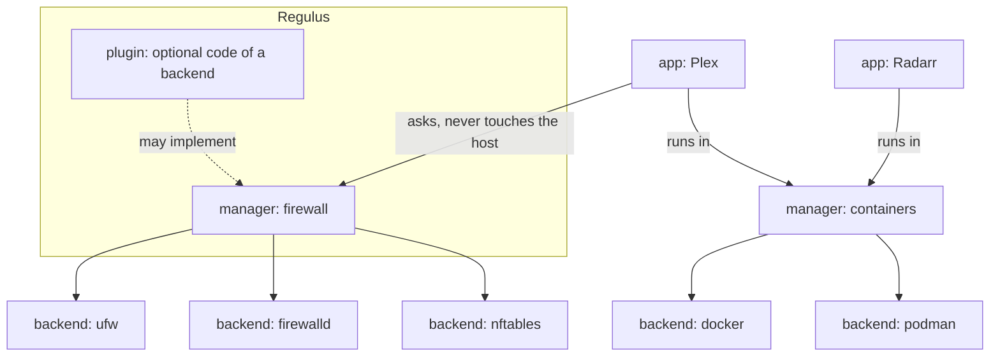

# Managers, backends and apps

**Status: design only. Nothing on this page is implemented.** It records the vocabulary and the direction agreed on 2026-11-19, so that the design issues of epic #286 start from the same words. Where a point is still open it says so.

Regulus will do more than observe servers. It will manage some of their functions (RAID, the firewall, containers, a VPN, Wake-on-LAN…) and run third-party software (Plex, Radarr, Sonarr, TriliumNext…). Four words were in use for overlapping things: *extension*, *plugin*, *add-on*, *snippet*. They are replaced by four words with four different meanings.

## The four terms

| Term | What it is | Is Regulus code? | Examples |
|---|---|---|---|
| **plugin** | A program that extends Regulus: a separate process speaking gRPC on a local socket, described by `plugin.yaml` ([plugins](plugins/README.md)). Unchanged. | yes | the code of a backend (when it is not built in), #163 |
| **manager** | A function of a server that Regulus manages, with one or more backends to choose from. | yes (the part that shows and changes its state) | RAID, firewall, containers, VPN, wake |
| **backend** | The real tool behind a manager. **One active backend per manager per server.** Regulus does not write its own version of what a backend already does. | no, it is an existing tool | mdadm, ufw, docker, tailscale |
| **app** | Third-party software that runs **in containers** on a server, described by a declarative manifest and taken from a catalog. | no | Plex, Radarr, Sonarr, TriliumNext |

Not used: **extension** and **add-on** (synonyms of plugin: two words for one thing), and **snippet** (no feature needs it; the word is free if a feature for saved commands or configuration fragments is ever designed).

Why *manager* and not *capability*: the glossary already uses **capability** for what a node type does by default (`relay`, `notifications`, `backup-storage`; #104, #160, #169). Using it twice would make "does this node have the firewall capability?" ambiguous. *Manager* is also the word the maintainer already used ("container management", "WOL manager").

### How they fit together

- A **manager** is a function; a **backend** is a tool; a server has at most one active backend for each manager. A manager that the server cannot support (no `ufw`, `firewalld` or `nftables` at all) is shown as unavailable, not as an error.
- A manager can be **built in** or implemented by a **plugin**. The rule is not decided: reading state is a collector in the core; changing state is dangerous and a candidate for a plugin with explicit permissions and isolation (see the open questions).
- An **app** needs no plugin and no Regulus API. It is data (a manifest) plus containers. If an app needs something from the host, such as an open port or a VPN, it asks the matching manager; the app never touches the host itself.

## Managers

The first column of each row is the manager; the backends are the tools Regulus would use. "Observe" means Regulus reads and shows state; "manage" means it also changes it. The scope of each manager is decided in its own issue, not here.

| Manager | Backends (proposed) | Notes | Issue |
|---|---|---|---|
| **Containers** | Docker, Podman | The runtime of apps. The common format is the Compose specification. Kubernetes is out of scope for now. | #289 |
| **Firewall** (of one server) | ufw, firewalld, nftables | nftables is the kernel layer; ufw and firewalld are front-ends on top of it, so they are not four equal choices. Regulus detects the one the distribution uses (ufw on Debian and Ubuntu, firewalld on RHEL and Fedora) and uses one per server. iptables is not supported. Docker and Podman also write firewall rules. Not the same as the firewall node of #284. | #290 |
| **VPN** | Tailscale first, then WireGuard, NetBird or Headscale | Optional, never required (a mandatory overlay was rejected for Regulus Access). Tailscale runs on the host, so it is a backend, not an app. | #291 |
| **Wake** | none to choose | Wake-on-LAN. A magic packet reaches only the local network, so the hub asks an agent on the same network to send it. A new state, *asleep*, next to offline. | #292 |
| **RAID** | mdadm; ZFS and Btrfs as filesystems | Already designed in #285 (observe or manage, storage or servers). LVM is **not** an alternative to mdadm: mdadm builds arrays, LVM builds logical volumes on top. | #285 |
| **Storage and volumes** | LVM, filesystems | The layer between the disks (#147) and the apps: mounts, logical volumes, free space. | #293 |
| **Shares** | Samba, NFS | | #294 |
| **Backup** | restic, borg | The function on each server. The backup node (#166) and the hub backup (#253) are separate issues; their relation is open. | #295 |
| **Reverse proxy and certificates** | Caddy, Traefik, nginx | Publishes apps with TLS. Nothing is public without an explicit choice. | #296 |
| **UPS** | NUT | Clean shutdown, power-return wake-up. | #297 |
| **System updates** | apt, dnf | The operating system's packages. **Not** Regulus's own updates ([updates](updates.md)). | #298 |
| **Scheduled jobs** | systemd timers, cron | One list of what runs on a schedule on a server. | #299 |
| **Virtual machines** | libvirt (KVM) | For what containers cannot do. A decision "build or not" first. | #300 |

The design of the model itself (what a manager is in code, how a backend is detected and chosen, built in or plugin, privileged actions, guards for dangerous operations) is #287.

## Apps

**Decision (2026-11-19): apps run in containers.** The alternative that was weighed was software installed natively in a dedicated volume as a systemd service. It was not chosen because every program would need its own installation, update and cleanup method, and Regulus would have to know each one. A container gives isolation, a clean removal and one format. The worry about "endless containers" is mostly about appearance: a container costs little, and the dashboard shows an app, not its containers.

What an app is, as proposed (the design is #288):

- A **manifest** built on the Compose specification, so that Docker and Podman both read it. Regulus adds what it needs: id, version, title, the Regulus versions it works with, the volumes it declares, the ports, the environment with **secret references** (never secrets in the manifest), the host resources it asks for (a media folder, a GPU) and the permissions it needs.
- A **data volume** per app, in a directory Regulus owns (for example `<apps dir>/<id>/data`). The volume is where the app's data lives; **removing an app can keep or delete it**, and the administrator chooses.
- A **catalog**: an index with checksums and signatures, like the plugin index of #20, with a `source` field so other catalogs can be added later (trust model: #23).
- The same three **update modes** as the core (`manual`, `download`, `automatic`), per app.
- **Redundancy:** a redundant hub replicates the **definition** of an app, never its data ([hub redundancy](hub-redundancy.md) and #113). The data is the business of the backup manager.

The first apps (Plex, Radarr, Sonarr, TriliumNext; then Jellyfin, Pi-hole, AdGuard Home, Nextcloud, Immich) are chosen in #301, after the manifest exists.

## What exists and what does not

| Part | Issue | Status |
|---|---|---|
| Vocabulary: plugin, manager, backend, app | #286 | **decided** (this page, the glossary, [decisions](decisions.md)); not in any code or UI string yet |
| Model of managers and backends | #287 | design only |
| Apps: manifest, catalog, lifecycle | #288 | design only |
| Container manager (Docker, Podman) | #289 | design only |
| Firewall, VPN, wake | #290, #291, #292 | design only |
| Storage, shares, backup, reverse proxy, UPS, system updates, scheduled jobs, virtual machines | #293 to #300 | design only, backlog (no milestone) |
| First apps | #301 | backlog |

Milestones: the model, the apps, the container manager and the three managers named by the maintainer (firewall, VPN, wake) are in **M6**, because they define how plugins are used and need #261 (what a plugin can do) first. The other managers have no milestone yet.

## Open questions

1. **Built in or plugin**, for the part of a manager that changes state. One rule for all managers is the goal (#287).
2. **Privileged actions.** Changing a firewall, an array or the Docker socket needs root. Whether this uses the root helper of the updates or a `sudoers.d` rule is open in #60; access to the Docker socket is equivalent to root and needs its own answer (#289).
3. **Guards.** An operation that can cut the administrator off (a firewall rule) or destroy data (an array) needs a guard: confirmation, a delay, an automatic revert, the audit log. What each manager must have is open (#287).
4. **Observe or manage**, manager by manager. RAID proposes *observe first* (#285).
5. **Isolation of plugins** that implement a manager (#267) and the permissions they ask for (#261).
6. **Overlap with node-type capabilities.** A *manager* is something a server does; a *capability* (#104, #169) is what a node type is expected to do. Whether a node type enables managers by default is not decided.
7. **Two issues on backup** (#166, #253) and one manager (#295): one mechanism or three.
8. **Italian labels.** The proposal is *gestione* for manager (for example "gestione firewall"), and *backend* and *app* unchanged. They are in the [glossary](glossary.md) and are not final.
