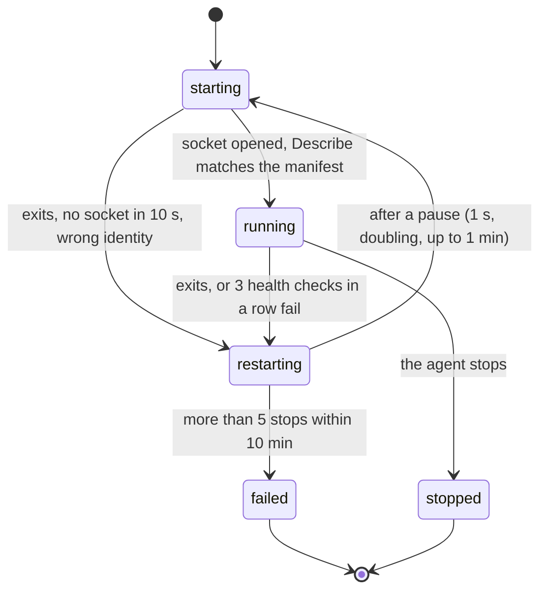

# Plugin runtime

How Regulus runs plugins (`internal/plugin/supervisor.go`). The supervisor is implemented and tested with real processes. It is started by the **agent** and by the **hub** when their `plugins_dir` is set; each starts the component of its own role.

## Turning it on

Plugins are off by default. Name a plugins directory in the configuration:

| Where | Setting | Flag | Variable | Default |
|---|---|---|---|---|
| agent | `plugins_dir` in `agent.yaml` | `--plugins-dir` | `REGULUS_AGENT_PLUGINS_DIR` | empty: no plugin runs |
| hub | `plugins_dir` in `config.yaml` (also `regulus config set plugins_dir ...`) | `--plugins-dir` | `REGULUS_PLUGINS_DIR` | empty: no plugin runs |

Restart the agent or the hub after changing it. The plugins directory is read once, at start: adding or removing a plugin needs a restart until the dashboard can install plugins (#20). A plugins directory that does not exist means no plugins; one that cannot be read is logged and shown as a problem in `GET /api/plugins`.

The hub runs its plugins beside its servers (`Hub.Serve`, `internal/hub/plugins.go`): the sockets are in `<data_dir>/plugins-run`, the plugins' data in `<data_dir>/plugins-data/<id>`. A plugin with only an `agent` component is not started on the hub, and the other way round. The hub's built-in agent runs no plugins.

## The plugins directory

```
<plugins_dir>/
  example-hello/          one directory per plugin, named after its id
    plugin.yaml
    bin/example-hello
  docker/
    plugin.yaml
    bin/docker-agent
```

- A directory whose `plugin.yaml` is missing or invalid, or whose name is not the plugin's `id`, is logged as a problem and skipped.
- Hidden entries (starting with `.`) and plain files are ignored.
- A **symbolic link** in place of a plugin directory is refused: a plugin must be a real directory.
- Only plugins with a component for the role are started: an agent starts `components.agent`.
- A plugin whose `api` or `requires` does not match this Regulus is **incompatible**: logged and never started.

## The life of a plugin



1. **Start.** The component's `command` is resolved (links followed, must stay inside the plugin directory, must be an executable regular file) and started with `args`, in the plugin directory, in **its own process group**, with a clean environment:

   | Variable | Value |
   |---|---|
   | `REGULUS_PLUGIN_SOCKET` | the Unix socket the plugin must listen on |
   | `REGULUS_PLUGIN_ID` | the plugin id |
   | `REGULUS_PLUGIN_ROLE` | `agent` or `hub` |
   | `REGULUS_CORE_VERSION` | the version of Regulus |
   | `REGULUS_PLUGIN_DATA_DIR` | a directory of its own, mode 0700: `<data_dir>/plugins-data/<id>` of the agent or the hub |
   | `PATH` | `/usr/local/bin:/usr/bin:/bin` |

   Nothing else from the host's environment is passed, so no setting or secret leaks into a plugin: on the hub, the environment holds the database password (`REGULUS_DATABASE_PASSWORD`). Tested: `TestAPluginGetsACleanEnvironment` (`internal/plugin`) and `TestTheHubRunsItsPlugins` (`internal/hub`), with the password set in the host's environment.
2. **Identity.** The plugin has 10 seconds to open its socket. Regulus then calls `Describe`, and the answer must give the **same `id`, `version` and `api` as the manifest**. A program that says it is something else is stopped. This catches a wrong binary in the right directory.
3. **Health.** Every 15 seconds Regulus calls `Health` (5 s timeout). **Three failures in a row** restart the plugin: no answer, an error, or `NOT_SERVING`. The plugin's message is kept as the reason.
4. **Restart.** A plugin that exits, or fails its checks, is started again after a pause. The pause starts at 1 second, doubles each time up to 1 minute (with a random spread), and starts over after the plugin ran for a minute.
5. **Giving up.** More than **5 stops within 10 minutes** make the plugin `failed`. It is not started again until the agent (or hub) restarts, and its last error is kept.
6. **Stop.** When the agent or the hub stops, every plugin's process group gets `SIGTERM`. Whatever is still running 10 seconds later gets `SIGKILL`. Children a plugin started are stopped with it, and also when the plugin exits by itself. The socket is removed.

What a plugin prints goes to the host's log (agent or hub), one entry per line, with the plugin id and `stream=stdout|stderr`. Lines are cut at 1000 bytes and at most 50 lines a second are kept, so a noisy plugin cannot flood the log.

### States

`starting`, `running`, `restarting`, `failed`, `incompatible`, `stopped`, with the number of restarts, the last error, when the plugin entered the state and the process id (`Supervisor.Status`).

Where they are shown:

- **`GET /api/plugins`** (permission `servers.read`): the hub's plugins and, for each connected agent with a plugins directory, the plugins it reported with its last metrics (every metrics interval, 10 s by default). See [HTTP API](../http-api.md) and `internal/hub/openapi.yaml`.
- **The console** (Status tab) and **`regulus status`** (text, `--plain` as `plugin.<id>=<state> <version> restarts=<n>`, `--json`): the hub's plugins, when the hub has a plugins directory.
- **The agent protocol**: `MetricsReport.plugins` and `plugins_enabled` (see [Versioning](../versioning.md)). An agent older than these fields reports none.
- The dashboard has the types and texts (`fetchPlugins` in `dashboard/src/api.ts`, the `plugins` catalog); the page itself is not built yet.

## Why a crash cannot take the agent down

- A plugin is **another process**. No plugin code is loaded into the agent: no Go `plugin` package, no shared library.
- The only link is a gRPC client on a Unix socket. Every call has a timeout, and an error is counted, never propagated.
- The supervisor runs **beside** the agent's connection to the hub, not inside it (`cmd/regulus/agent.go`, `startPlugins`). `agent.Run` never waits for a plugin; it only reads the supervisor's status for its reports.
- On the hub it runs beside the HTTP and agent servers (`internal/hub/plugins.go`); the API only reads its status.
- Nothing a plugin does makes the supervisor return an error. Only an unreadable plugins directory does, and then the agent logs it and runs without plugins.

Tested in `internal/plugin/supervisor_test.go`: a plugin that keeps crashing ends `failed` while another keeps running with the same process id. On the hub, `TestTheHubRunsItsPlugins` (`internal/hub/plugins_test.go`) runs the example plugin built from source beside one that crashes at every start: the crashing one ends `failed`, the example keeps running as the same process, the hub keeps answering, and `GET /api/plugins` shows both. Also tested: an impostor, an unhealthy plugin, one that never opens its socket and ignores `SIGTERM`, a child process outliving its plugin, a command that leads outside its directory, and the example plugin built from source.

## The contract on the socket

`proto/regulus/plugin/v1/plugin.proto`, served **by the plugin**:

| RPC | When | The plugin answers |
|---|---|---|
| `Describe(host_api_version, host_version, role)` | once per start | its `id`, `version`, `api_version` |
| `Health()` | every 15 s | `SERVING`, or `NOT_SERVING` with a message for the administrator |

This is the whole contract today. What a plugin can offer and ask for is the next design step ([Plugins](README.md), open question 1). The contract follows the rules of [Versioning](../versioning.md): fields are only added, and a change of meaning raises the plugin API version.

## Security

What is protected today:

- the agent's process and memory (separate process);
- the agent's environment and settings (clean environment);
- the files of other plugins and the agent's data, against mistakes: each plugin has its own data directory, mode 0700. This is **not** a protection against a malicious plugin, which runs as the same user;
- the system against a forgotten process: process groups are stopped;
- a wrong program: identity check, and the command must stay inside the plugin directory.

What is **not** protected yet, and must be before plugins come from anywhere but this repository (#20, #23):

- **Same user, same sandbox.** A plugin runs as the agent's user (`regulus`) under the agent's systemd hardening. It can read what the agent can read, including the agent's key in its data directory. On the hub it runs as the hub's user and can read what the hub can read: the database file (SQLite), `secret.key`, the CA key and `/etc/regulus/regulus.env` with the database password. The clean environment keeps the password out of the plugin's variables, **not** out of its reach: a hub plugin must be trusted as much as the hub. A user per plugin, or a stricter sandbox (systemd transient units, Landlock), is an open question.
- **No signature check.** Whatever is in the plugins directory runs. Who can write that directory controls what runs, so keep it owned by root and not writable by `regulus`.
- **Permissions are not enforced.** The manifest's `permissions` are a request with no effect yet.
- **No resource limits** per plugin beyond the agent's own (memory, CPU, number of processes).

The restart rules bound how often a broken plugin costs a start: at most 6 starts in 10 minutes, then nothing.

## Not verified

The runtime has run in tests with real processes, sockets and signals, on Linux. It has **not** run on an installed agent or hub under its systemd unit. The unit's hardening (`MemoryDenyWriteExecute`, `SystemCallFilter`, `ProtectSystem`) applies to plugins as well, and some plugins may need it relaxed. A `[Test]` issue should cover this before the first real plugin (#22).
